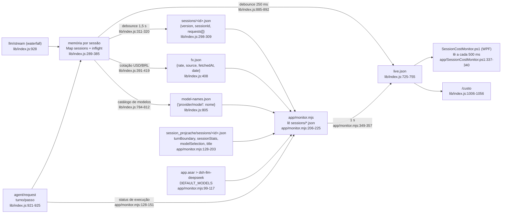

# Como funciona o `dsh-session-cost-monitor`

Documento técnico do plugin **dsh-session-cost-monitor** (medidor de custo e latência
por sessão do DeepSeek Harness), escrito a partir do código real. Cada afirmação
técnica cita `arquivo:linha`; os caminhos são relativos à raiz do plugin
(`~/.dsh/plugins/dsh-session-cost/`) ou absolutos quando o arquivo está fora dela.

Referências de caminho usadas aqui:

| Apelido | Caminho |
| --- | --- |
| raiz do plugin | `C:\Users\marcelo\.dsh\plugins\dsh-session-cost\` |
| dados de execução | `C:\Users\marcelo\.dsh\session-cost\` |
| cache de projeção do DSH | `C:\Users\marcelo\.dsh\storages\session_projcache\sessions\<id>.json` |
| adaptador oficial (dentro do app instalado) | `C:\Users\marcelo\AppData\Local\Programs\DeepSeek Harness\resources\app.asar` |

---

## 1. Visão geral

O plugin entrega três coisas independentes entre si:

1. **Comando `/custo` no chat** (e o alias `/cost`): resumo da sessão atual —
   requisições medidas, tempo, tokens, custo em US$ e em R$, divisão
   entrada/saída, economia de cache e a faixa de preço vigente.
   Registrado em `lib/index.js:1065-1068`; o relatório é montado em
   `lib/index.js:456-516`.
2. **Monitor visual nativo no Windows** (janela WPF, três abas), alimentado por
   `live.json`: `app/SessionCostMonitor.ps1:1-14`.
3. **Persistência por sessão** em `~/.dsh/session-cost/`, com escrita atômica e
   debounce, para sobreviver a HMR do plugin e reinício do app:
   `lib/index.js:272-283` e `lib/index.js:311-320`.

O que ele mede, por chamada de modelo (`lib/index.js:4-8` e `lib/index.js:983-999`):

- **duração total** (wall clock) e **TTFT** (tempo até o primeiro chunk);
- tokens de **entrada (cache miss)**, **cache read**, **cache write** e **saída**;
- **custo em US$** pela tabela de preços (peak/off-peak) e **em R$** pela cotação
  do dólar do dia, buscada na web e cacheada em disco (`lib/index.js:391-419`);
- **economia de cache** = quanto os tokens lidos do cache deixaram de custar por
  não virem como miss (`lib/index.js:174-175`).

Recursos que aparecem na UI: sessões **em processamento** com consumo acumulado
(`lib/index.js:679-724`), **multi-idioma** (pt-BR, en, es, zh-CN) no comando e na
janela (`lib/i18n.js:13-205`, `app/locales/*.json`) e **nomes de exibição do
modelo** lidos do catálogo do adapter (`app/monitor.mjs:99-117`).

---

## 2. Arquitetura: três peças desacopladas

| Peça | Arquivo | Papel |
| --- | --- | --- |
| 1. Plugin host | `lib/index.js` | Escuta o waterfall `llm/stream` (`lib/index.js:928`), mede cada chamada, persiste `sessions/<id>.json` (`lib/index.js:983-999`), grava `live.json` (`lib/index.js:867-883`) e expõe o comando (`lib/index.js:1065`). |
| 2. Agregador Node | `app/monitor.mjs` | Lê `sessions/*.json`, `fx.json` e o cache de projeção do DSH (`app/monitor.mjs:206-225`, `app/monitor.mjs:128-203`), recalcula o snapshot com a **mesma** `buildSnapshot`/`resolveConfig` do plugin (`app/monitor.mjs:19-26`) e regrava `live.json` a cada 1 s (`app/monitor.mjs:306-327`, `app/monitor.mjs:349-357`). |
| 3. Janela WPF | `app/SessionCostMonitor.ps1` | Lê `live.json` a cada 500 ms e desenha as três abas (`app/SessionCostMonitor.ps1:337-340`, `app/SessionCostMonitor.ps1:563-566`). |

Por que são desacopladas:

- o **monitor nunca importa o plugin em execução no DSH**; ele importa o *arquivo*
  `lib/index.js` do disco (`app/monitor.mjs:19-26`) e lê os dados gravados. Trocar
  o código do plugin exige reiniciar o DSH, mas o app visual continua correto
  assim que o arquivo em disco é atualizado (comentário em `app/monitor.mjs:9-10`).
- a janela depende apenas do **formato de `live.json`** (versionado: `version: 1`,
  `lib/index.js:726`), não de eventos internos do DSH.
- o plugin host é opcional para o app: se o DSH não estiver rodando, o agregador
  ainda agrega o histórico já persistido.

Prova prática do desacoplamento neste ambiente: as entradas gravadas em
`sessions/*.json` **não** têm as chaves `temperature` e `reasoningEffort`, embora
`lib/index.js:991-992` as escreva — ou seja, o plugin carregado na memória do DSH
é anterior ao código instalado, e o monitor segue exibindo o consumo. O efeito
visível é a coluna de esforço por requisição sair `—` até o DSH ser reiniciado.

---

## 3. Fluxo de dados



Ponto importante: **`live.json` tem dois escritores**. O plugin grava o snapshot a
partir da memória (`lib/index.js:357-359`) e o agregador regrava o arquivo a cada
ciclo a partir do disco (`app/monitor.mjs:325`). O agregador detecta a corrida
comparando o `mtime` do arquivo antes e depois de montar o snapshot e, se o plugin
gravou no meio, ele **descarta o próprio ciclo** (`app/monitor.mjs:308-309`,
`app/monitor.mjs:321-323`).

---

## 4. Formatos de arquivo (`~/.dsh/session-cost/`)

| Arquivo | Quem grava | Chaves / formato | Referência |
| --- | --- | --- | --- |
| `sessions/<sessionId>.json` | plugin | `version: 1`, `sessionId`, `requests[]`; cada requisição tem `at`, `endedAt`, `durationMs`, `ttftMs`, `provider`, `model`, `purpose`, `temperature`, `reasoningEffort`, `turn`, `step`, `usage{inputTokens, outputTokens, cacheReadTokens, cacheWriteTokens, reasoningTokens}`, `peak`, `costUsd`, `error` | `lib/index.js:302`, `lib/index.js:983-999`, `lib/index.js:140-150` |
| `fx.json` | plugin e agregador | `rate`, `source`, `fetchedAt`, `date`, `cached` (e `stale`/`unavailable` quando aplicável) | `lib/index.js:408`, `lib/index.js:417-418`, `app/monitor.mjs:224` |
| `model-names.json` | plugin | mapa `"provider/model": "nome do catálogo"` (`ctx.llm.listModels`) | `lib/index.js:784-812` |
| `live.json` | plugin + agregador | snapshot completo (tabela na seção 5) | `lib/index.js:725-755`, `app/monitor.mjs:325` |
| `monitor.pid` | agregador | `{pid, startedAt}`; ao encerrar, `{pid: 0, stoppedAt}` | `app/monitor.mjs:244`, `app/monitor.mjs:334` |

Detalhes de comportamento:

- O nome do arquivo de sessão é **URL-encoded**: `encodeURIComponent(sessionId)`
  (`lib/index.js:294`); o agregador aplica o mesmo encoding ao procurar a
  requisição concluída (`app/monitor.mjs:251`). Para ids no formato UUID nada muda;
  para ids com `/`, `:` ou espaços, o nome do arquivo difere do id.
- A gravação é **atômica** (arquivo temporário + `rename`) para o app poder ler a
  qualquer instante (`lib/index.js:272-283`).
- O plugin mantém no máximo `maxRequestsPerSession` requisições por sessão,
  descartando as mais antigas (`lib/index.js:334-341`).
- No boot, o plugin recarrega do disco as sessões já medidas (`lib/index.js:362-381`,
  chamada em `lib/index.js:778`).
- `monitor.pid` funciona como lock: se o PID estiver vivo, o agregador imprime
  `monitor: já existe um agregador rodando` e sai (`app/monitor.mjs:228-243`).

---

## 5. Snapshot `live.json` — todas as chaves

Gerado por `buildSnapshot` (`lib/index.js:649-755`). Chaves presentes no arquivo:

| Chave | Conteúdo | Origem |
| --- | --- | --- |
| `version` | `1` — versão do formato | `lib/index.js:726` |
| `app` | `"dsh-session-cost"` — identifica o produtor | `lib/index.js:727` |
| `updatedAt` | instante (ms) em que o snapshot foi montado | `lib/index.js:728` |
| `fx` | `{rate, date, source, fetchedAt, stale, unavailable}`; `null` se nunca houve cotação | `lib/index.js:729-738` |
| `modelNames` | mapa `"provider/model"` → nome de exibição | `lib/index.js:739`, `lib/index.js:653` |
| `today` | `{date, ...summarize(daily)}`: totais do dia local | `lib/index.js:740`, `lib/index.js:658` |
| `totals` | `summarize(all)`: totais de todas as sessões medidas | `lib/index.js:741` |
| `running` | `{sessionCount, sessionIds[], sessions[], ...summarize(inflight∪status)}`: sessões **em processamento agora** | `lib/index.js:714-724`, `lib/index.js:679-713` |
| `daily` | histórico por dia (mais recente primeiro), até 31 dias | `lib/index.js:743`, `lib/index.js:592-603` |
| `sessions` | até 25 sessões (mais recentes primeiro) com `sessionId`, `title`, `reasoningEffort`, `lastModel`, `lastProvider` + `summarize` | `lib/index.js:659-672` |
| `activeSessionId` | id da sessão mais recente (primeira de `sessions`) | `lib/index.js:745` |
| `activeSessionTitle` | título da sessão mais recente | `lib/index.js:746` |
| `activeReasoningEffort` | esforço de raciocínio da sessão mais recente | `lib/index.js:747` |
| `activeModel` | último modelo usado na sessão mais recente | `lib/index.js:748` |
| `lastRequest` | última requisição medida, com `sessionId` + valores em R$ | `lib/index.js:749`, `lib/index.js:606-634` |
| `recent` | 20 requisições mais recentes (todas as sessões) | `lib/index.js:674-677` |
| `inflight` | chamadas de modelo em curso no plugin, com `elapsedMs` | `lib/index.js:751` |
| `peak` | faixa de preço vigente **no instante do snapshot** (`true` = peak) | `lib/index.js:752`, `lib/index.js:118-122` |
| `peakPolicy` | política configurada (`auto` \| `peak` \| `off-peak`) | `lib/index.js:753` |

O objeto produzido por `summarize` (usado em `today`, `totals`, `running` e em cada
item de `daily`/`sessions`) tem:
`requests`, `durationMs`, `tokens{inputTokens, outputTokens, cacheReadTokens, cacheWriteTokens, inputTotalTokens}`,
`costUsd`, `costInputUsd`, `costOutputUsd`, `savingsUsd`, `costBrl`, `costInputBrl`,
`costOutputBrl`, `savingsBrl`, `lastAt`, `firstAt`, `errors`, `models[]`
(`lib/index.js:572-588`).

A janela consome essas chaves assim: cartões HOJE e SESSÕES EM ANDAMENTO usam
`today`/`running` (`app/SessionCostMonitor.ps1:420-440`), o cronômetro usa
`inflight[0]` (`app/SessionCostMonitor.ps1:453-454`) e o rodapé usa `fx`/`updatedAt`.

---

## 6. Cálculo de custo

### 6.1 Semântica dos tokens: `inputTokens` é **cache miss**

Confirmado no adaptador oficial dentro do app instalado
(`resources/app.asar`, função `parseChunkUsage`):

```js
const input = Math.max(0, promptTokens - cacheReadTokens - cacheWriteTokens);
const usage = {
    input, output: outputTokens,
    cacheRead: cacheReadTokens, cacheWrite: cacheWriteTokens,
    totalTokens: input + outputTokens + cacheReadTokens + cacheWriteTokens,
    ...
};
```

ou seja, o `inputTokens` que chega ao plugin já vem **descontado** das leituras e
escritas de cache. A própria projeção de uso do DSH trata esse campo como não
cacheado (`uncachedInputTokens: usage.inputTokens`, também no `app.asar`). O
comentário do plugin registra a mesma conclusão em `lib/index.js:152-158`.

Por isso:

- `inputTotalTokens = inputTokens + cacheReadTokens + cacheWriteTokens`
  (`lib/index.js:186`);
- o relatório exibe `miss: {1}, cache hit: {2}, cache write: {3}`
  (`lib/i18n.js:46`).

### 6.2 Preço peak / off-peak

- `DEFAULT_PRICES` em USD por 1M tokens (`lib/index.js:35-61`), com a nota de que
  peak = 2x off-peak (`lib/index.js:30-34`).
- Janela peak em **UTC**: segunda a sexta, `01:00–04:00` e `06:00–10:00`
  (`lib/index.js:109-115`); `peakPolicy` pode forçar a faixa (`lib/index.js:118-122`).
- Tabelas default (off-peak):

| modelo | cache hit | cache miss | saída |
| --- | --- | --- | --- |
| `deepseek-flash` | 0.003 | 0.15 | 0.60 |
| `deepseek-v4-pro` | 0.022 | 0.66 | 1.98 |
| `deepseek-chat` / `deepseek-reasoner` | 0.028 | 0.28 | 0.42 |
| `default` (fallback) | 0.003 | 0.15 | 0.60 |

  (`lib/index.js:35-61`; os dois últimos têm `peak` igual ao `offPeak`.)

### 6.3 Fórmulas

`computeCost` (`lib/index.js:159-188`):

```
missRate  = preço cacheMiss na faixa vigente
hitRate   = preço cacheHit  na faixa vigente
writeRate = preço cacheWrite, ou cacheMiss se não houver cacheWrite

inputCostUsd  = miss/1M * missRate
              + cacheRead/1M  * hitRate
              + cacheWrite/1M * writeRate
outputCostUsd = output/1M * outputRate
costUsd       = inputCostUsd + outputCostUsd
savingsUsd    = max(0, cacheRead/1M * (missRate − hitRate))
```

- `readRate` aceita número puro ou `{peak, offPeak}` (`lib/index.js:125-129`).
- `mergeRate` normaliza sobrescritas de preço na config (`lib/index.js:132-137`).
- `savingsUsd` é exatamente `cacheRead × (preço miss − preço hit)`
  (`lib/index.js:174-175`).
- **O custo é recalculado na leitura**: `entryCost` chama `priceFor` + `computeCost`
  para cada entrada (`lib/index.js:196-203`), e `summarize`/`totalsOf` usam
  `entryCost(cfg, entry)`, não o `costUsd` gravado (`lib/index.js:555-559`,
  `lib/index.js:447-451`). O `costUsd` persistido só é usado quando não há config
  (`lib/index.js:552-554`). Consequência: ajustar `config.prices` corrige também as
  requisições já medidas.
- `summarize` também converte para R$ multiplicando pela cotação
  (`lib/index.js:580-583`); sem cotação (`rate` não finito) os campos BRL ficam
  `null` (`lib/index.js:539`).

---

## 7. Comando `/custo`

Definição: nome em `cfg.commandName` (default `custo`, `lib/index.js:244`), aliases
em `cfg.aliasCommands` (default `['cost']`, `lib/index.js:237-239`), registrados em
`lib/index.js:1058-1068`; `recordInput: false` (o comando não vira histórico do
chat, `lib/index.js:1062`) e hint de entrada `[json|cotacao|reset|help]`
(`lib/index.js:1061`). O `input` é normalizado com `trim().toLowerCase()`
(`lib/index.js:1007`), então maiúsculas não importam.

| Modo | Reconhecido quando o input é | O que devolve | Referência |
| --- | --- | --- | --- |
| vazio (ou qualquer outro texto) | — | `renderReport`: resumo + tabela requisição a requisição, com US$/R$ e a faixa vigente | `lib/index.js:1055`, `lib/index.js:456-516` |
| `json` | `json` | JSON com `{sessionId, fx, totals, costBrl, requests}` | `lib/index.js:1037-1053` |
| `cotacao` | `cotacao`, `cotação`, `fx`, `dolar`, `dólar` | força a cotação do dia (`force: true`); devolve linha da cotação + relatório; se indisponível, `kind: 'error'` | `lib/index.js:1018-1035` |
| `reset` | `reset`, `zerar` | zera as requisições medidas da sessão atual (`store.reset`) | `lib/index.js:1013-1016`, `lib/index.js:342-346` |
| `help` | `help`, `ajuda`, `?`, `ayuda`, `帮助` | texto de ajuda no idioma resolvido | `lib/index.js:1010-1012`, `lib/i18n.js:23-30` |

Comportamento do relatório:

- sessão sem requisição medida: devolve `nothingMeasured` + `sendMessage`
  (`lib/index.js:458-460`);
- cabeçalho da tabela: `# | hora | modelo | esforço | tempo | ttft | miss | cache hit | saída | US$ | R$`
  (`lib/i18n.js:43`);
- totais: tokens de entrada (com miss/cache hit/write), saída, total, custo US$,
  cotação usada, custo R$, divisão entrada/saída em US$ e R$ e economia de cache
  (`lib/index.js:485-510`);
- última linha: faixa vigente calculada **no momento do comando**
  (`lib/index.js:511-512`).

Observação: tanto o comando quanto o plugin buscam a cotação com cache de
`fx.cacheHours` (default 6 h), aceitando valor antigo marcado como `stale` quando a
rede falha (`lib/index.js:391-419`).

---

## 8. Critério de "sessão em processamento"

O app precisa saber **quais sessões estão processando agora**, inclusive durante a
execução de ferramentas entre duas chamadas de modelo. A fonte usada é o cache de
projeção do próprio DSH
(`~/.dsh/storages/session_projcache/sessions/<id>.json`), lido por
`app/monitor.mjs:128-151`:

| Sinal | Campo no cache de projeção | Significado |
| --- | --- | --- |
| turno aberto | `record.rows.turnBoundary.val.openTurnStartSeq !== null` | o agente está processando (modelo ou ferramenta) |
| ferramentas pendentes | `record.rows.sessionStats.val.pendingCalls` (contagem de chaves > 0) | há chamada de ferramenta em execução |
| passo aberto | `record.rows.sessionStats.val.openStep !== null` | passo em curso |

A sessão é marcada `running` se **qualquer** um dos três for verdadeiro
(`app/monitor.mjs:138-146`). O agregador procura o arquivo do cache com três
candidatos de nome — id completo, id sem o prefixo `session-` e id com o prefixo
(`app/monitor.mjs:131-133`) — porque o plugin grava o id da sessão no formato que
o DSH usa no `llm/stream`.

No `buildSnapshot`, as sessões em processamento são a **união** dos ids em
`inflight` com os ids cujo status veio `running: true` (`lib/index.js:683-690`), e o
custo exibido é o consumo acumulado das sessões dessa união
(`lib/index.js:719-723`). Uma sessão que aparece no status mas não tem requisição
medida entra com zeros (`lib/index.js:691-713`).

### Por que isso substituiu o `inflight`

O `inflight` vive apenas na memória do plugin: é um `Map` com chave
`${sessionId}:${startedAt}` (`lib/index.js:933-946`), removido no `finally` da
chamada (`lib/index.js:982`). O agregador, porém, regrava `live.json` inteiro a
cada segundo (`app/monitor.mjs:325`) — e o snapshot dele é montado a partir do
**disco**, não da memória do plugin. Numa corrida de escrita, o ciclo do agregador
sobrescrevia o `inflight` gravado pelo plugin e o cronômetro "EM ANDAMENTO"
desaparecia. Duas defesas resolveram o problema:

1. **Critério próprio e persistente**: `turnBoundary.openTurnStartSeq` e
   `sessionStats.pendingCalls/openStep` ficam no disco, então o agregador calcula
   "em processamento" sozinho, sem depender do plugin recarregado
   (`app/monitor.mjs:128-151`). É isso que aparece no cartão SESSÕES EM ANDAMENTO
   (`app/SessionCostMonitor.ps1:420-444`).
2. **Preservação do `inflight`**: `carryInflight` copia os itens do `live.json`
   anterior e os reinjeta no snapshot (`app/monitor.mjs:265-277`, usado em
   `app/monitor.mjs:314`), com descarte seguro:
   - sai se o item não tiver `startedAt` válido, se tiver mais de **30 s**, ou se
     `startedAt` estiver no futuro além de 5 s (`app/monitor.mjs:271-272`);
   - sai quando a sessão passa a ter uma requisição concluída a partir de
     `startedAt` (`sessionRecordedAfter`, `app/monitor.mjs:250-254`);
   - além disso, o ciclo inteiro é abortado se o `mtime` de `live.json` mudou
     durante a montagem (`app/monitor.mjs:321-323`).

Assim, a UI mostra o cronômetro da chamada em curso enquanto ela existir, e o
cartão de sessões ativas se mantém correto mesmo quando só o turno (sem chamada de
modelo) está aberto.

---

## 9. Multi-idioma

### 9.1 Comando e relatório — `lib/i18n.js`

- Idiomas registrados: `pt-BR`, `en`, `es`, `zh-CN` (`lib/i18n.js:13-18`), com os
  dicionários em `lib/i18n.js:20-205`. Chaves incluem `commandDescription`, `help`,
  `nothingMeasured`, `resetDone`, `fxUnavailable`, `fxLine`, `reportTitle`,
  `session`, `measured`, `models`, `totalTime`, `tableHead`, `tableSep`, `totals`,
  `inputTokens`, `outputTokens`, `allTokens`, `costUsd`, `costBrl`, `fxRate`,
  `costSplitUsd`, `costSplitBoth`, `savings`, `savingsBoth`, `fxUnavailableShort`,
  `band`, `bandPeak`, `bandOffPeak`, `bandPolicy*`, `footer`, `error`, `unknown`.
- `normalizeLanguage` (`lib/i18n.js:208-218`): casa o id exato; senão usa o idioma
  primário (`pt` → `pt-BR`, `zh` → `zh-CN`, e qualquer `xx-YY` → `xx`).
- `resolveLanguage` (`lib/i18n.js:226-238`), nesta ordem:
  1. `config.language`, se não for `auto` (`lib/i18n.js:227-228`);
  2. `DSH_LOCALE`, depois `DSH_LANG`, depois `LANG` (`lib/i18n.js:229`);
  3. locale do sistema via `Intl.DateTimeFormat().resolvedOptions().locale`
     (`lib/i18n.js:232`);
  4. `en` como último recurso (`lib/i18n.js:237`).
- `createTranslator` (`lib/i18n.js:245-254`): fallback para `en`, arrays de ajuda
  unidas por `\n` e substituição de `{0}`, `{1}`, … pelos argumentos.
- A config resolve o tradutor em `lib/index.js:240-243` e o usa no comando, na
  descrição e no relatório (`lib/index.js:1011`, `lib/index.js:1060`,
  `lib/index.js:456-457`).

### 9.2 Janela WPF — `app/locales/*.json`

- Parâmetro `-Language auto|pt-BR|en|es|zh-CN`
  (`app/SessionCostMonitor.ps1:15-20`); `Resolve-UiLanguage` tenta o valor exato,
  depois o idioma primário e, se `auto`, o `CurrentUICulture` do Windows, caindo
  para `en` (`app/SessionCostMonitor.ps1:32-46`).
- A cultura da thread é ajustada para o idioma (separador decimal e datas):
  `app/SessionCostMonitor.ps1:50`.
- Os dicionários são carregados de `app/locales/<lang>.json`, com fallback
  `pt-BR` e depois `en` (`app/SessionCostMonitor.ps1:52-61`); a função `T` faz a
  substituição de `{n}` (`app/SessionCostMonitor.ps1:64-74`).
- São quatro arquivos: `app/locales/pt-BR.json`, `en.json`, `es.json`,
  `zh-CN.json`.

Para acrescentar um idioma: copiar um bloco em `DICTIONARIES` (`lib/i18n.js:20`),
registrar a chave em `LANGUAGES` (`lib/i18n.js:13`) e criar
`app/locales/<lang>.json` com as mesmas chaves.

---

## 10. Configuração

Chaves aceitas em `config` (patch do perfil) e o default aplicado por
`resolveConfig` (`lib/index.js:220-258`):

| Chave | Tipo | Default | Efeito | Referência |
| --- | --- | --- | --- | --- |
| `commandName` | string | `custo` | nome do comando (sem a barra) | `lib/index.js:244` |
| `aliasCommands` | string[] | `['cost']` | nomes extras registrados para o mesmo handler | `lib/index.js:237-239`, `lib/index.js:1066-1068` |
| `language` | string | `auto` | `auto`/`pt-BR`/`en`/`es`/`zh-CN`; resolvido por `resolveLanguage` | `lib/index.js:240`, `lib/i18n.js:226-238` |
| `storeDir` | string | `path.join(dshHome(), 'session-cost')` | onde ficam `sessions/`, `fx.json`, `model-names.json`, `live.json` | `lib/index.js:246`, `lib/index.js:213-217` |
| `persist` | boolean | `true` | `false` desliga toda a escrita em disco (e a leitura do histórico) | `lib/index.js:247`, `lib/index.js:299`, `lib/index.js:347-359` |
| `maxRequestsPerSession` | number | `500` (mínimo 10) | teto de requisições guardadas por sessão | `lib/index.js:248`, `lib/index.js:337-339` |
| `peakPolicy` | `auto` \| `peak` \| `off-peak` | `auto` | força a faixa de preço; `auto` usa a janela UTC | `lib/index.js:249`, `lib/index.js:118-122` |
| `prices` | objeto | `DEFAULT_PRICES` | tabela USD/1M tokens por modelo, com `cacheHit`, `cacheMiss`, `output` e opcional `cacheWrite`, cada um número ou `{peak, offPeak}` | `lib/index.js:223-236`, `lib/index.js:35-61` |
| `fx.cacheHours` | number | `6` (mínimo 0) | validade da cotação em cache; `0` força buscar sempre | `lib/index.js:253`, `lib/index.js:395` |
| `fx.timeoutMs` | number | `8000` (mínimo 1000) | timeout de cada provedor de cotação | `lib/index.js:254`, `lib/index.js:404` |
| `fx.url` | string | — | provedor extra consultado **antes** dos embutidos; tenta `USDBRL.bid`, `rates.BRL` ou `rate` | `lib/index.js:255`, `lib/index.js:398-400` |

Notas:

- A chave de preço é procurada como `provider/model` e, se não existir, como
  `model` e depois `default` (`lib/index.js:191-194`).
- Provedores de cotação embutidos: `economia.awesomeapi.com.br/last/USD-BRL` e
  `open.er-api.com/v6/latest/USD` (`lib/index.js:63-74`); a fonte usada fica
  registrada em `fx.json` e no relatório (`lib/index.js:408`, `lib/index.js:504`).
- `dshHome()` respeita `DSH_HOME` e cai em `~/.dsh` (`lib/index.js:213-217`).
- O plugin declara apenas builtins do Node (sem dependências de runtime), o que o
  mantém instalável em qualquer perfil (`lib/index.js:14-15`, `lib/index.js:19-23`).

---

## 11. Instalação e publicação

Instalação (README, seção *Instalação*):

```sh
dsh plugin --profile desktop add github:MarceloNGVargas/DSH-Cost          # do repositório
dsh plugin --profile desktop add "github:MarceloNGVargas/DSH-Cost#v1.0.0" # versão fixada
pnpm pack                                                                 # tarball
dsh plugin --profile desktop add ./dsh-session-cost-monitor-1.0.0.tgz
```

- O pacote é um **bundle** no sentido oficial do DSH: declara
  `dsh.bundle.patch: ./cordis.patch.yml` (`package.json:21-28`), e o patch insere o
  plugin no perfil (`cordis.patch.yml:25-27`).
- Requisitos: DSH `>=0.2.0-rc.1` (`package.json:22-24`), peer
  `@deepseek-ai/cordis ~4.0.4` (`package.json:29-31`), Node `>=20`
  (`package.json:58-60`). O plugin é JavaScript puro — sem build nem script de
  instalação (README, seção *Instalação*).
- Publicação: git + release (o monorepo oficial não recebe plugins de terceiros).
  O fluxo é `pnpm pack --dry-run`, `git tag v1.0.0`, `git push origin v1.0.0` e
  `gh release create ... --generate-notes`.
- A remoção é `dsh plugin --profile desktop remove dsh-session-cost-monitor`; tudo
  também é acessível pela página **Plugins** e pela ferramenta `plugin_manager`
  (`install_bundle`/`remove_bundle`).

App visual:

- `app\abrir-monitor.cmd` (ou `app\abrir-monitor.ps1`) garante o agregador Node em
  segundo plano e abre a janela; se `node.exe` não for encontrado, avisa e a janela
  mostra o último `live.json` sem atualização contínua
  (`app/abrir-monitor.ps1:17-45`).
- `app\instalar-no-inicio.ps1` cria o atalho em
  `%APPDATA%\Microsoft\Windows\Start Menu\Programs\Startup`
  (`app/instalar-no-inicio.ps1:16-43`), com `-Remover` para desfazer;
  `app\instalar-na-area-de-trabalho.ps1` cria o atalho na Área de Trabalho
  (`app/instalar-na-area-de-trabalho.ps1:16-44`).
- A janela exige Windows PowerShell 5.1 com WPF (`-STA`)
  (`app/SessionCostMonitor.ps1:1-3`), `-Tab 0..2` para abrir numa aba e
  `-NoTopmost` para não fixar no topo (`app/SessionCostMonitor.ps1:15-20`).

Verificação rápida:

```sh
node test/smoke.mjs          # suíte local, sem DSH
node app/monitor.mjs --once  # gera live.json uma vez e sai
```

---

## 12. Limitações conhecidas

- **Preços de tabela.** Os valores são estimativas oficiais de USD/1M tokens
  (`lib/index.js:30-34`); descontos, créditos e impostos não são modelados.
- **Feriados chineses não são modelados.** `isPeakUtc` só considera dia da semana e
  hora UTC (`lib/index.js:109-115`); a própria tabela documenta a exceção de
  feriados chineses (`lib/index.js:32`).
- **`inputTokens` é cache miss.** O total de entrada exibido soma
  `inputTokens + cacheReadTokens + cacheWriteTokens` (`lib/index.js:186`), e a
  semântica vem do adapter oficial (seção 6.1).
- **Sessões sem requisição medida não aparecem.** Só buckets com
  `requests.length > 0` entram no snapshot (`lib/index.js:654`,
  `app/monitor.mjs:310-313`); requisições feitas com o plugin desligado ou antes da
  instalação não entram no relatório (`lib/index.js:456-460`).
- **WPF só no Windows.** O monitor é PowerShell 5.1 + WPF
  (`app/SessionCostMonitor.ps1:1-3`); o comando `/custo` e o agregador Node são
  multiplataforma.
- **O agregador não lê a config do perfil.** `app/monitor.mjs:33` chama
  `resolveConfig({})`, ou seja, usa preços, `storeDir` e `peakPolicy` **default**.
  Um `config.prices` customizado no patch do perfil vale para o comando, mas o
  `live.json` regravado pelo monitor a cada segundo (`app/monitor.mjs:325`)
  sobrescreve o snapshot do plugin com a tabela default. O mesmo vale para
  `storeDir` fora do default: o monitor não o encontraria
  (`app/monitor.mjs:34-38`).
- **Teto de dados exibidos:** 25 sessões (`lib/index.js:672`), 20 requisições
  recentes (`lib/index.js:676`), 31 dias de histórico (`lib/index.js:592`) e
  `maxRequestsPerSession` por sessão (`lib/index.js:337-339`).
- **`inflight` é heurístico:** o agregador descarta itens com mais de 30 s
  (`app/monitor.mjs:272`); como o critério primário é o cache de projeção, a lista
  de sessões em processamento continua correta (`app/monitor.mjs:128-151`).
- **Esforço por requisição depende do plugin recarregado.** O campo
  `reasoningEffort` por requisição só existe em entradas gravadas por
  `lib/index.js:992`; o app também lê o esforço da projeção `modelSelection`
  (`lib/index.js:818-841`, `app/monitor.mjs:157-175`), que é por sessão.
- **`reasoningTokens` é somado, mas não precificado nem exibido** — o custo de
  saída usa `outputTokens` (`lib/index.js:148`, `lib/index.js:172`).
- **Requisições sem `sessionId`** caem no bucket literal `sem-sessao`
  (`lib/index.js:930`), que passa a aparecer como uma "sessão" nos totais.

---

## 13. Pontos de atenção para quem for manter

- `live.json` tem dois produtores; mexer no formato exige atualizar
  `buildSnapshot` **e** o consumidor WPF (`app/SessionCostMonitor.ps1:337-340`).
  O campo `version` existe para versionar isso (`lib/index.js:726`).
- Toda constante de preço deve ser alterada em `DEFAULT_PRICES`
  (`lib/index.js:35-61`); o cálculo é centralizado em `computeCost`
  (`lib/index.js:159-188`) e reaproveitado pelo comando, pelo snapshot e pelo
  agregador.
- O teste `test/smoke.mjs` cobre exatamente as regras críticas: preços
  peak/off-peak, semântica `inputTokens` = miss, economia de cache, janela UTC,
  medição de stream, persistência, snapshot, os modos do comando, config e i18n
  (`test/smoke.mjs:31-53`, `test/smoke.mjs:55-58`).
- O adaptador de LLM é a fonte da verdade dos tokens; se a semântica mudar no
  futuro, o ponto de verificação é a função `parseChunkUsage` do
  `dsh-llm-deepseek` dentro do `app.asar` instalado.
